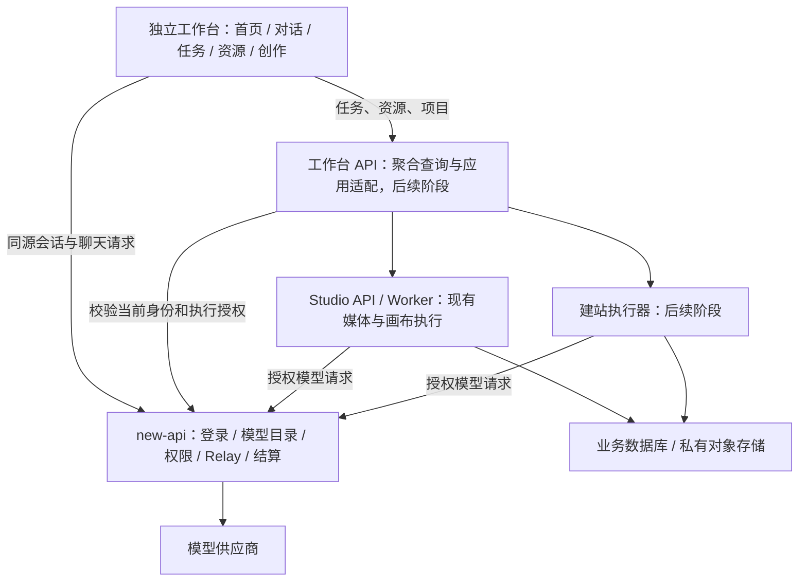

# Elink 独立创作工作台架构

状态：独立首页与导航已进入本轮实现；任务、资源、图像、视频、建站的统一接入为后续阶段。本文描述当前代码和目标架构，未落地部分均明确标记。

## 1. 产品形态

Elink 是用户日常使用的独立创作应用。首页提供统一输入、模型选择、创作入口和最近对话；侧栏围绕首页、对话、任务、资源与创作工具组织。视觉参考用户提供的 LobeHub 截图：浅色侧栏、独立白色内容面板、大输入区、轻量推荐、低饱和点缀。使用自有 Elink 品牌与几何图形，保留导入组件许可。

new-api 是模型服务与管理控制台。渠道、模型广场、API Key、用户、权限、额度和结算仍由它负责，通过主站入口访问。创作应用不再套在管理控制台的 iframe 中。

独立应用采用同源部署，首版地址为 `/apps/workspace/`；保留现有 `/apps` 应用中心作为兼容入口。独立域名不是本阶段前提，后续若使用独立域名，需先设计正式的跨域登录授权，不能通过 URL 携带 Token。

## 2. 已有实现与本轮变更

| 单元 | 当前责任 | 本轮处理 |
| --- | --- | --- |
| `apps/workspace`（原 `apps/chat`） | LobeHub MIT 浏览器子集、流式聊天、本机历史、模型选择 | 升级为独立应用，增加首页、导航、搜索与模块接入页，聊天按路由延迟加载 |
| `apps/studio/web` | 画布、时间线和媒体编辑器，React 19 | 保持现有工程与完整页面，通过工作台入口打开 |
| `apps/studio/backend` 与 Worker | 项目、媒体资源、生成任务、Agent 执行 | 本轮不迁移表、不改任务执行链；后续提供适配接口 |
| `services/platform` | 当前只有服务健康与应用目录诊断 | 将来演进为工作台 API 聚合服务；当前不视为已经有权限、任务、资源能力 |
| 独立 `new-api` 仓库 | 账号、模型、渠道、分组、限流、计费 | 增加工作台文档代理与旧地址跳转，沿用既有聊天 API |

`apps/workspace` 暂留 React 18，以兼容现有导入组件。Studio 与诊断页独立构建，不强制把 React 19 或画布依赖打入首页。TypeScript 的 React 类型和 Vite 的 React 运行时解析限定在工作台自身版本，避免 monorepo 混用两套 React。

## 3. 目标服务边界



不为每个创作类型新建一套用户、模型、计费和资源系统。首阶段为单体前端中的业务模块；后端复用 Studio 的执行与资源能力，再按真实的运行隔离需求拆出建站执行器。`services/platform` 只聚合和适配，不重复计算费用、不直连模型供应商。

Studio 当前已有业务对象保留为原始事实源。统一任务中心初期做带来源的聚合视图，不把 Studio 队列复制为第二个可写队列。任务状态、取消与重试交回所属执行器；将来迁移所有权必须单独设计迁移，不能同时向两套系统双写状态。

## 4. 页面与路由

| URL | 页面 | 首版状态 |
| --- | --- | --- |
| `/apps/workspace/` | 首页：问候、输入、模型选择、创作卡片、真实本机最近对话 | 实现 |
| `/apps/workspace/chat` | 聊天：流式生成、模型/分组、历史、助手设定 | 实现 |
| `/apps/workspace/chat?conversation=<id>` | 打开当前账号的本机对话 | 实现；ID 不参与身份认证 |
| `/apps/workspace/tasks` | 统一任务中心 | 接入说明页，无伪造任务 |
| `/apps/workspace/resources` | 统一资源库 | 接入说明页，无伪造素材 |
| `/apps/workspace/images` | 图像创作 | 接入说明页，提供已有 Studio 入口 |
| `/apps/workspace/videos` | 视频创作 | 接入说明页，提供已有 Studio 入口 |
| `/apps/workspace/sites` | 网站创作 | 接入说明页，无可用发布按钮 |
| `/apps/studio/` | 现有完整画布与时间线 | 保持独立文档 |

首页的“开始对话”携带输入、模型和分组进入新对话，用户在聊天页发送；页面跳转本身不产生付费模型调用。搜索目前只覆盖应用入口和当前账号的本机对话标题。未来统一搜索必须按每个来源的资源权限查询。

侧栏入口与可用状态统一登记在 `features/workspace/modules.ts`，不在多处维护不同状态。`ready` 只代表已实现的工作台流程，不代替后端模型授权。

旧 `/apps/chat` 在客户端离开管理控制台并打开 `/apps/workspace/chat`；旧 `/apps/lobehub/` 由后端跳转至新地址。旧历史的 `elink-lobehub:v1:<userId>` 键保持不变，同源用户无需重新导入。

## 5. 前端目录与依赖方向

```text
apps/workspace/src/
  main.tsx                     React 根、主题、BrowserRouter
  features/workspace/
    WorkspaceApp.tsx           身份启动、全局导航、搜索、路由装配
    HomePage.tsx               首页输入、模块卡片、最近对话
    ModulePage.tsx             未接入模块的真实状态说明
    modules.ts                路由与导航元数据
    workspace.css             工作台样式
  features/chat/
    ChatWorkspace.tsx         既有聊天交互与会话生命周期
  features/Conversation/      导入并维护的 LobeHub 对话展示组件
  lib/session.ts              主站会话适配
  lib/api.ts                  主站聊天目录与 Relay
  lib/history.ts              按账号隔离的本机历史
  types.ts                    当前领域类型
```

后续新增 `features/images`、`features/videos`、`features/sites`、`features/tasks`、`features/resources`，由路由懒加载。页面调用本模块 API 层，不直接操作别的模块 Store，不引用相邻 new-api 仓库源码。

等至少两个真实调用方出现后，再把会话、模型目录客户端与公共 API 类型提升到 `packages/*`。不预先创建只转发一层的空 SDK 或万能插件系统。已有 `packages/contracts` 是诊断目录契约，不把未来生成协议误当已支持接口导出。

## 6. 统一任务与资源契约（后续设计）

任务摘要至少包含：`id`、`owner_id`、`project_id`、`kind`、`source`、`source_task_id`、`state`、`created_at`、`updated_at`、`model_id`、`group`、`output_resource_ids`、`error_code`、`retryable`。前端状态为 `queued / running / succeeded / failed / cancelled / unknown`；取消请求被接受不等于供应商已停止，更不等于退款。

资源摘要至少包含：`id`、`owner_id`、`project_id`、`type`、`name`、`mime_type`、`size`、`source_task_id`、`source_resource_id`、`created_at`。资源使用对象存储 ID 或受控下载 API，不存永久公开 URL。缩略图、预览与下载按当前权限签发短期地址。资源可被多个创作对象引用，删除前检查引用并提供明确回收策略。

前端不展示浏览器生成的百分比作为真实进度；供应商未给进度时展示阶段状态。SSE 用事件 ID 重连并补查询快照；先支持轮询，再根据真实需求升级事件流。

生成提交由服务端生成/校验请求 ID，按用户和操作作用域记录幂等结果。网络超时且供应商是否受理未知时进入 `unknown` 并查询原任务；不得直接自动重发计费请求。失败重试是新的显式操作，只有确认前次未受理或有供应商幂等保证时才可透明重试。

聊天当前是前台流式请求，离开页面会中止连接；它不是后台持久任务。后台长任务能力单独建设后再承诺离线持续运行。

## 7. 身份、执行与费用

- 浏览器继续使用同源 HttpOnly 刷新 Cookie，短期访问 Token 仅放内存；退出和切换账号清除/重载应用状态。
- 所有资源和任务请求服务端验证主站身份与对象归属；主站管理员不自动获得其他用户作品访问权。
- 模型 ID、分组与端点能力来自 new-api。提交时再验证，不信任前端目录缓存或浏览器传来的地址、供应商密钥。
- 统一任务 API 进入生产前，`services/platform` 必须先接入鉴权和逐对象授权；现有健康检查接口不能充当业务鉴权。
- 当前 Studio 执行凭据仍有访问令牌时效限制。长视频与后台建站上线前，需新增服务端的有限执行授权：绑定用户、任务、模型/分组、有效期、操作范围；可撤销、可审计，不能用共享管理员 Key 绕过。
- 前端展示主站费用信息和结算状态；Studio、工作台、建站执行器均不另造钱包或积分。取消和失败是否退费由主站实际结算记录决定。
- 网站预览运行在隔离源/沙箱，不携带主站 Cookie，不允许读取工作台 DOM；生成代码的构建与运行放在受限执行环境。预览与发布是独立操作，发布必须有用户明确动作与可回滚版本。

这些为目标约束，不代表长任务授权、统一幂等或建站沙箱已经实现。认证参考 OWASP Authentication、Session Management、Authorization Cheat Sheets 与 ASVS 5.0.0；本轮复用已有会话机制，不引入新登录协议。

## 8. 分阶段落地与验收

| 阶段 | 交付 | 验收标准 |
| --- | --- | --- |
| A 本轮 | 独立首页、侧栏、路由、现有聊天迁入、状态页、架构文档 | 无管理控制台 iframe；首页草稿与模型传入聊天；旧历史可读；深链刷新/前进后退、移动端、主题、退出正常 |
| B 共享基础 | 受保护的工作台 API、Studio 任务/资源聚合、执行授权方案 | 真实任务和资源可查；跨用户拒绝；授权撤销；断线可恢复；不重复提交 |
| C 图像 | 独立参数面板、提交、结果画廊与资源保存 | 真实主站模型生成；素材归属正确；请求与结算可追溯 |
| D 视频 | 长任务、参考素材、结果播放、重试与取消 | 超时/重启恢复；取消与计费状态准确；首帧素材跨模块复用 |
| E 建站 | 项目文件、隔离构建与预览、版本、发布适配器 | 无主站凭据泄露；预览不污染工作台；用户确认发布、版本回滚 |

优先完成 B 再接 C/D，避免每个页面自己写任务轮询和上传系统。Studio 作为高级编辑器持续可用，不以迁移完整画布为统一首页的前置条件。

## 9. 部署与回滚

同源边缘路由：`/apps/workspace/*` → Workspace 静态服务；`/apps/studio/*` → Studio；主站 API 与管理页面 → new-api。工作台服务仍使用本地 3102 端口，开发由主站 5173 代理；浏览器通过 5173 访问以共享登录。

主站客户端也注册 `/apps/workspace` 与 `/apps/workspace/*` 交接路由：登录成功后的 SPA 导航必须重新加载工作台 HTML，保留查询参数与片段；根路径补齐尾斜杠，避免误入主站 404。此处只负责应用交接，仍使用主站原有认证守卫。

优先配置 `EXT_WORKSPACE_UPSTREAM_URL`，暂时兼容已有 `EXT_CHAT_UPSTREAM_URL`。工作台静态镜像的 nginx 使用 SPA fallback；静态资产长缓存、HTML 不缓存。独立服务允许回退前端镜像而不改动用户或计费数据。

本轮无业务数据库迁移，无历史删除；仅保留原本机历史键。后续服务端会话迁移需要用户知情导入、去重、导入失败保留原数据和跨账号测试。发布前同时验证边缘路径、资源路径、深链接和会话刷新；不能只验证 Vite 根页。

### 2026-10-23：新页签登录恢复修复

- Chrome 实际失败为 refresh 返回 429；工作台此前把所有无法取得 Token 的情况都显示成登录过期。现在区分服务端拒绝、限流与网络故障：只有认证失效显示登录入口，网络故障支持重新连接，限流完整遵守 `Retry-After` 并在窗口结束后自动重试。没有降低或清除服务端限流。
- 独立工作台属于受保护入口，冷启动必须请求主站 refresh；缺少 `new_api_has_session` 提示 Cookie 不再作为匿名判定。并发请求继续合并，刷新锁、同源 Cookie、内存 Token 与服务端鉴权保持不变。会话 SID 冲突时先清除旧 Token 再进行一次恢复，避免回退到旧身份。
- 参考 [OWASP Authentication Cheat Sheet](https://cheatsheetseries.owasp.org/cheatsheets/Authentication_Cheat_Sheet.html) 的登录限流和错误处理，以及 [Session Management Cheat Sheet](https://cheatsheetseries.owasp.org/cheatsheets/Session_Management_Cheat_Sheet.html) 的 Cookie、会话验证和凭据存储控制；本次没有引入新登录协议或跨标签页令牌广播。
- 验证：6 项新增会话回归（无提示 Cookie、并发、401、完整 1200 秒限流窗口、网络恢复、SID 冲突），工作台共 17 项单元测试和生产构建通过。用户 Chrome 中从主站 AI应用新开页签已恢复 admin 首页，无需重新输入密码。
